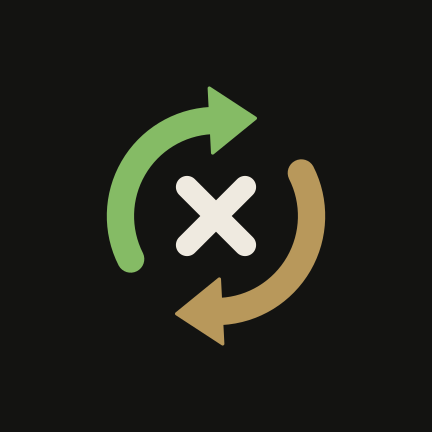

# CurrenciX

   
   

   

**CurrenciX** is a [simple](https://en.wikipedia.org/wiki/KISS_principle) currency converter — a handy travel companion, not a tool for realtime financial business.

It's a fork of [Currencies](https://github.com/sal0max/currencies) by Maximilian Salomon. See [NOTICE.md](NOTICE.md) for a summary of what changed in the fork.

## Features

* Eight exchange rate providers to choose from, with a fallback for when your main one fails:
   * [Frankfurter.app](https://frankfurter.dev/) — 30+ currencies, provided by the European Central Bank
   * [Open Exchangerates](https://openexchangerates.org/) — 160+ currencies with hourly updates (requires a free API key)
   * [AllRatesToday](https://allratestoday.com/) — ~160 mid-market rates, updated about every minute (requires an API key)
   * [InforEuro](https://commission.europa.eu/funding-tenders/procedures-guidelines-tenders/information-contractors-and-beneficiaries/exchange-rate-inforeuro_en) — the European Commission's monthly accounting rates for 150+ pairs
   * [Bank of Canada](https://www.bankofcanada.ca/rates/exchange/daily-exchange-rates/) — ~23 CAD rates
   * [Norges Bank](https://www.norges-bank.no/en/topics/Statistics/exchange_rates/) (Norway) — ~40 rates
   * [Bank Rossii](https://cbr.ru/eng/currency_base/daily/) (Russia) — ~44 rates against the Ruble
   * [Bank of Israel](https://www.boi.org.il/en/economic-roles/statistics/foreign-exchange-market/exchange-rates/) — ~14 ILS rates
* Built-in calculator (`+ − × ÷`, brackets, percent), recent pairs, and paste an amount straight from the clipboard.
* Fee manager: global exchange/bank fees plus per-pair overrides — see the "true cost" alongside the mid-market rate, and compare your cards.
* Rate chart from a week to 5 years or a custom range, with statistics, and rate alerts that notify you when a pair reaches your rate.
* Historical rates: convert against rates from any prior date.
* Cart: a running list of prices converted into your currency, with quantities, tip / tax, split by person, a budget, trips, and receipt scanning on the device.
* Convert a price selected in any app ("Convert currency" in the text-selection menu), plus a home-screen widget, a Quick Settings tile and launcher shortcuts.
* Optional background rate refresh, encrypted backup & restore, and an app lock.
* Material 3 with colors from your wallpaper; light, dark and OLED themes; two panes on tablets and foldables.
* 33 languages, with right-to-left layouts for Hebrew, Arabic and Farsi.
* Ad-free and telemetry-free.

Written in Kotlin with Jetpack Compose, min SDK 33 (Android 13), targeting Android 17 (SDK 37).

## Screenshots

   
   

## Development

See [CONTRIBUTING.md](CONTRIBUTING.md). Deeper docs — architecture, build flavors, CI/CD, security — live in [`docs/markDown/`](docs/markDown/).

## Legal & compliance

- [Privacy Policy](docs/markDown/privacy-policy.md) — the app collects no personal data; see the policy for the per-jurisdiction posture (GDPR, UK GDPR, CCPA family, LGPD, PIPEDA, APPI, POPIA, PDPA, PIPL, Australia Privacy Act, Israeli PPL incl. Amendment 13, COPPA, ePrivacy).
- [Terms of Service](docs/markDown/terms-of-service.md) — usage terms, warranty disclaimer, rate-accuracy notice. Governed by the laws of Israel.
- [Accessibility Statement](docs/markDown/accessibility-statement.md) — WCAG 2.1 AA target covering IS 5568, EN 301 549 / EAA, ADA / §508.
- [Compliance Posture](docs/markDown/compliance-posture.md) — applicability under EU AI Act, DSA/DMA, financial-services regimes, EAR / EU Dual-Use, EU CRA, Play Data Safety, F-Droid.
- Project website: [currencix.machlev.org](https://currencix.machlev.org/).
- [SECURITY.md](SECURITY.md) — vulnerability reporting, coordinated disclosure, support period, SBOM.

## License

Copyright © 2020 Maximilian Salomon (upstream Currencies) · CurrenciX fork © 2026 Elior Machlev.

Licensed under [GPL-3.0-or-later](https://www.gnu.org/licenses/gpl-3.0.html).
