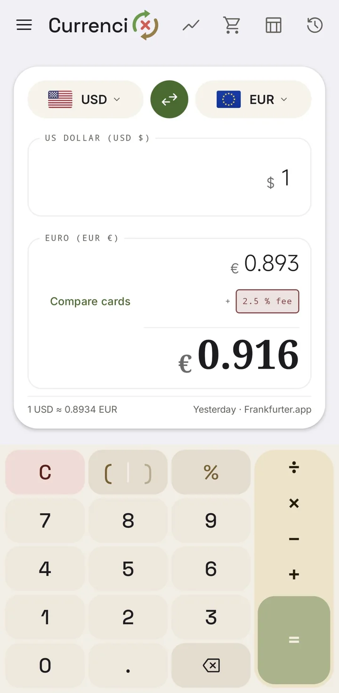
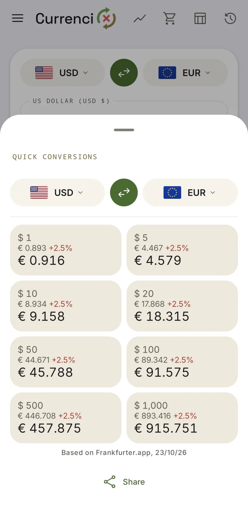
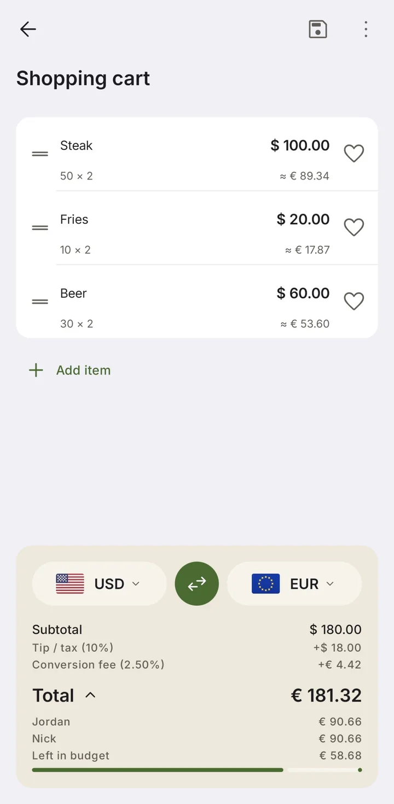
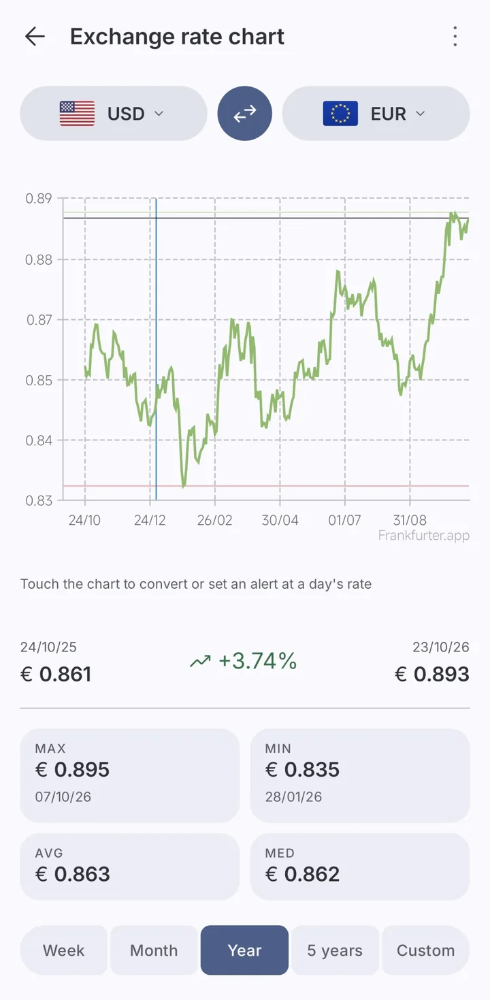

<div align="center">

<picture>
  <source media="(prefers-color-scheme: dark)" srcset="art/brand/currencix-mark-dark.gif">
  
</picture>

# CurrenciX

**A simple, private currency converter for Android.**<br>
A handy travel companion, not a tool for real-time financial business.

[](https://github.com/EliorMachlev/CurrenciX/actions/workflows/build.yaml)
[](https://www.bestpractices.dev/projects/15831)
[](https://securityscorecards.dev/viewer/?uri=github.com/EliorMachlev/CurrenciX)
[](COPYING)
[](docs/markDown/overview.md)

[Website](https://currencix.machlev.org/) · [Features](https://currencix.machlev.org/features.html) · [Providers](https://currencix.machlev.org/providers.html) · [Privacy](https://currencix.machlev.org/privacy.html) · [Docs](docs/markDown/)

<br>

&nbsp;
&nbsp;
&nbsp;


</div>

---

## ✨ Highlights

| Feature | What you get |
|---|---|
| 💱 **Convert anything** | A calculator keypad (`+ − × ÷`, brackets, percent), your recent pairs one tap away, a price pasted from the clipboard, or past dates' rates back to 2010. |
| 💳 **The true cost** | Add your card's or bank's exchange fee, globally or per pair, see the real price beside the mid-market one, and compare your cards. |
| 📈 **Charts & alerts** | A week to five years of history, or a custom range up to ten, with high, low, average and median, and a notification when a pair reaches your rate. |
| 🛒 **Cart** | A list of prices converted into your currency, with quantities, tip or tax, a budget, a split by person, trips, and receipt scanning on the device. |
| 📲 **Everywhere on your phone** | "Convert currency" in any app's text-selection menu, a home-screen widget, a Quick Settings tile and launcher shortcuts. |
| 🎨 **Looks right** | Material 3 with colors from your wallpaper; light, dark and pure-black themes; two panes on tablets and foldables; 33 languages, right to left where they read that way. |
| 🔒 **Private** | No ads, no analytics, no account. An optional app lock, private requests and encrypted backups. Nothing about you leaves the phone. |

## 🏦 Exchange rate providers

Eight sources, and a fallback for when your main one is down. Details in [api-providers.md](docs/markDown/api-providers.md).

| Provider | Source | Currencies | Updates | API key |
|---|---|---|---|---|
| [Frankfurter.app](https://frankfurter.dev/) | European Central Bank | ~33 | Business days | — |
| [Open Exchangerates](https://openexchangerates.org/) | Commercial aggregator | 160+ | Hourly | Free key |
| [AllRatesToday](https://allratestoday.com/) | Mid-market interbank | ~160 | About every minute | Key |
| [InforEuro](https://commission.europa.eu/funding-tenders/procedures-guidelines-tenders/information-contractors-and-beneficiaries/exchange-rate-inforeuro_en) | European Commission | ~150 | Monthly | — |
| [Bank of Canada](https://www.bankofcanada.ca/rates/exchange/daily-exchange-rates/) | Central bank | ~23 | Business days | — |
| [Norges Bank](https://www.norges-bank.no/en/topics/Statistics/exchange_rates/) | Central bank | ~40 | Business days | — |
| [Bank Rossii](https://cbr.ru/eng/currency_base/daily/) | Central bank | ~44 | Business days | — |
| [Bank of Israel](https://www.boi.org.il/en/economic-roles/statistics/foreign-exchange-market/exchange-rates/) | Central bank | ~14 | Business days | — |

## 📦 Get it

CurrenciX hasn't had its first release yet. Releases will be published on [GitHub Releases](https://github.com/EliorMachlev/CurrenciX/releases): signed APKs (one per CPU type, and a universal one), their `SHA256SUMS`, and an SBOM of every library they ship. Android 17 and later also check a post-quantum signature. An F-Droid build is prepared.

Until then, build it yourself:

```bash
git clone https://github.com/EliorMachlev/CurrenciX.git
cd CurrenciX
./gradlew assembleFdroidDebug   # JDK 21 or newer
```

## 🧱 Built with

[Kotlin](https://kotlinlang.org/) · [Jetpack Compose](https://developer.android.com/compose) with Material 3 · Navigation 3 · DataStore · Retrofit + OkHttp · WorkManager · [Glance](https://developer.android.com/develop/ui/compose/glance) · [Vico](https://github.com/patrykandpatrick/vico) charts · [Tesseract](https://github.com/adaptech-cz/Tesseract4Android) OCR · Bouncy Castle + Tink

Checked on every change by Android Lint, detekt, Qodana, Semgrep, CodeQL and Gitleaks, with unit, screenshot and fuzz tests. See [ci-cd.md](docs/markDown/ci-cd.md).

## 📚 Documentation

| Doc | What's in it |
|---|---|
| [Overview](docs/markDown/overview.md) | What the app does, at a glance |
| [Architecture](docs/markDown/architecture.md) | How it's put together, and why |
| [Build & flavors](docs/markDown/build-and-flavors.md) | Toolchain, `fdroid` and `play`, signing and releases |
| [Providers](docs/markDown/api-providers.md) | Every rate source, caching and fallback |
| [CI / CD](docs/markDown/ci-cd.md) | Workflows, checks and benchmarks |
| [Security](docs/markDown/security.md) | Supply chain, network, backups, signing |
| [Exceptions](docs/markDown/exceptions.md) | The only suppressed findings, and why |

## 🤝 Contributing

Bug fixes are welcome; for new features, open an issue first. Start with [CONTRIBUTING.md](CONTRIBUTING.md) and the [contributor guide](docs/markDown/contributing.md).

Found a vulnerability? Please report it privately, as [SECURITY.md](SECURITY.md) describes.

## ⚖️ Legal

[Privacy Policy](docs/markDown/privacy-policy.md) · [Terms of Service](docs/markDown/terms-of-service.md) · [Accessibility Statement](docs/markDown/accessibility-statement.md) · [Compliance Posture](docs/markDown/compliance-posture.md) · [SECURITY.md](SECURITY.md)

## 📄 License

CurrenciX is a fork of [Currencies](https://github.com/sal0max/currencies) by Maximilian Salomon; [NOTICE.md](NOTICE.md) sums up what changed.

Copyright © 2020 Maximilian Salomon (upstream Currencies) · CurrenciX fork © 2026 Elior Machlev.<br>
Licensed under [GPL-3.0-or-later](COPYING).
