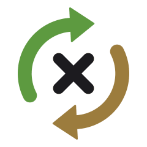
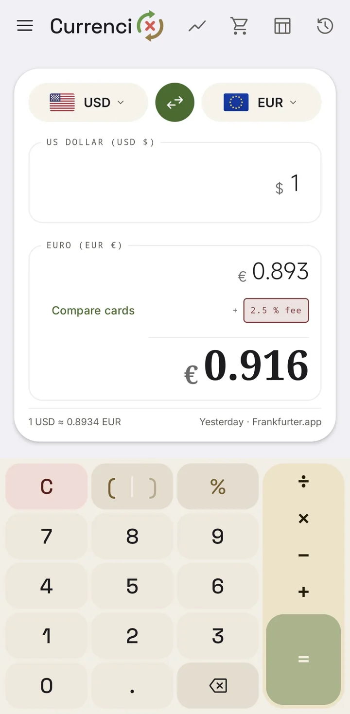
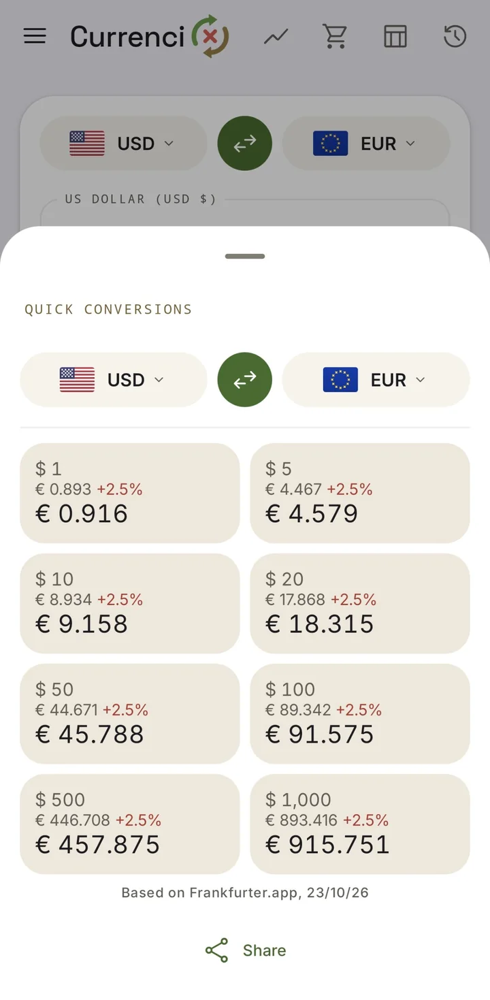
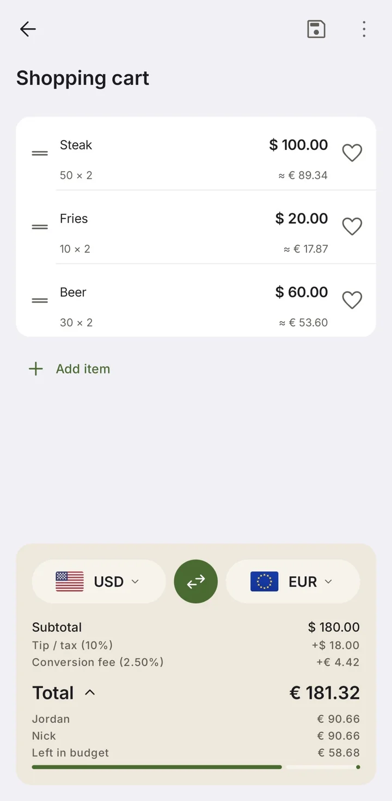
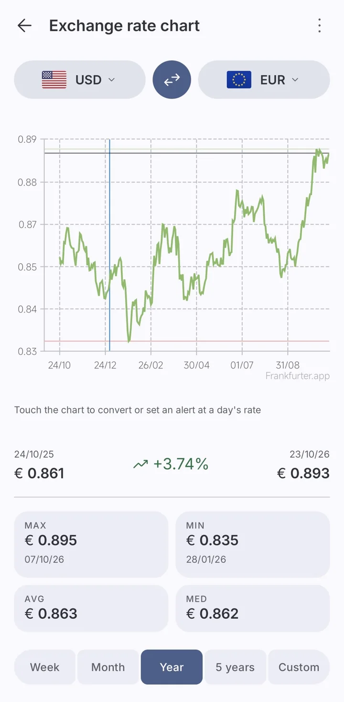

<div align="center">

<a href="https://currencix.machlev.org/">
  <picture>
    <source media="(prefers-color-scheme: dark)" srcset="art/brand/currencix-mark-dark.gif">
    
  </picture>
</a>

# CurrenciX

**A simple, private currency converter for Android.**<br>
A handy travel companion, not a tool for real-time financial business.

[](https://github.com/EliorMachlev/CurrenciX/releases)
[](https://github.com/EliorMachlev/CurrenciX/actions/workflows/build.yaml)
[](https://www.bestpractices.dev/projects/15831)
[](https://securityscorecards.dev/viewer/?uri=github.com/EliorMachlev/CurrenciX)
[](COPYING)
[](docs/markDown/engineering/build.md)

**[Website](https://currencix.machlev.org/)** · [Features](https://currencix.machlev.org/features.html) · [Providers](https://currencix.machlev.org/providers.html) · [Privacy](https://currencix.machlev.org/privacy.html) · [Releases](https://github.com/EliorMachlev/CurrenciX/releases) · [Docs](docs/markDown/README.md)

<br>

<table>
  <tr>
    <td></td>
    <td></td>
  </tr>
  <tr>
    <td></td>
    <td></td>
  </tr>
</table>

More on the [website](https://currencix.machlev.org/features.html).

</div>

---

## ✨ Highlights

| Feature | What you get |
|---|---|
| 💱 **Convert anything** | 173 currencies, a calculator keypad (`+ − × ÷`, brackets, percent), starred currencies and recent pairs one tap away, a price pasted from the clipboard, or past dates' rates back to 2010; abroad, it offers the local currency. |
| 💳 **The true cost** | Add your card's or bank's exchange fee, globally or per pair, see the real price beside the mid-market one, and compare your cards. |
| 📈 **Charts & alerts** | A week to five years of history, or a custom range up to ten, with high, low, average and median, how today compares with the period's average, and a notification when a pair reaches your rate. |
| 🛒 **Cart** | A list of prices converted into your currency, with quantities, tip or tax, a budget, a split by person, trips with dates, spending per day and a checklist before you go, and receipt scanning on the device. |
| 📲 **Everywhere on your phone** | "Convert currency" in any app's text-selection menu, a home-screen widget, a Quick Settings tile and launcher shortcuts. |
| 🎨 **Looks right** | Material 3 with colors from your wallpaper; light, dark and pure-black themes; two panes on tablets and foldables; 32 languages, right to left where they read that way. |
| 🔒 **Private** | No ads, no analytics, no account. An optional app lock, screenshot blocking, private requests, pinned certificates for every rate server, and backups you can encrypt (Argon2id + AES-256-GCM); API keys sealed in the phone's Keystore; crash reports stay on the phone until you share them. |

## 🏦 Exchange rate providers

Eight sources, with a fallback for when your main one is down: [Frankfurter](https://frankfurter.dev/) (European Central Bank), [Open Exchangerates](https://openexchangerates.org/), [AllRatesToday](https://allratestoday.com/), [InforEuro](https://commission.europa.eu/funding-tenders/procedures-guidelines-tenders/information-contractors-and-beneficiaries/exchange-rate-inforeuro_en), and the central banks of [Canada](https://www.bankofcanada.ca/rates/exchange/daily-exchange-rates/), [Norway](https://www.norges-bank.no/en/topics/Statistics/exchange_rates/), [Russia](https://cbr.ru/eng/currency_base/daily/) and [Israel](https://www.boi.org.il/en/economic-roles/statistics/foreign-exchange-market/exchange-rates/). Coverage, update frequency and API keys for each: [providers](docs/markDown/product/providers.md), or the [website's providers page](https://currencix.machlev.org/providers.html).

## 📦 Get it

Download the latest APK from [GitHub Releases](https://github.com/EliorMachlev/CurrenciX/releases): one signed APK for Android 13 or later on arm64-v8a devices (nearly all current phones), plus `SHA256SUMS`, an SBOM of every library it ships and its signed build provenance. Versions before 1.0 are marked pre-releases. Android 17 and later also check a post-quantum signature; an F-Droid build is prepared.

To check a download, from the folder holding the release files (the second command asks GitHub; for the offline variant, see [verifying a release](docs/markDown/engineering/release.md#verifying-a-release)):

```bash
sha256sum --check --ignore-missing SHA256SUMS
gh attestation verify *.apk --repo EliorMachlev/CurrenciX
```

How a release is made and signed: [release](docs/markDown/engineering/release.md).

The upstream **Currencies** app is on [Google Play](https://play.google.com/store/apps/details?id=de.salomax.currencies) and [F-Droid](https://f-droid.org/packages/de.salomax.currencies/) under its own package name. To build CurrenciX (`com.eliormachlev.currencix`) yourself ([build guide](docs/markDown/engineering/build.md)):

```bash
git clone https://github.com/EliorMachlev/CurrenciX.git
cd CurrenciX
./gradlew assembleFdroidDebug   # JDK 21 or newer
```

## 🧱 Built with

[Kotlin](https://kotlinlang.org/) · [Jetpack Compose](https://developer.android.com/compose) with Material 3 · Navigation 3 · DataStore · Retrofit + OkHttp · kotlinx.serialization · WorkManager · [Glance](https://developer.android.com/develop/ui/compose/glance) · [Vico](https://github.com/patrykandpatrick/vico) charts · [Tesseract](https://github.com/adaptech-cz/Tesseract4Android) OCR · Bouncy Castle + Tink

Checked on every change by Android Lint, detekt, Qodana, Semgrep, CodeQL, Gitleaks, OSV-Scanner and Licensee, with unit, screenshot and fuzz tests; each change to the app is also built twice to check the F-Droid release is reproducible. OWASP Dependency-Check audits the shipped libraries twice a week. See [CI / CD](docs/markDown/engineering/ci-cd.md).

## 📚 Documentation

Start at the [documentation index](docs/markDown/README.md): [architecture](docs/markDown/engineering/architecture/README.md), [build](docs/markDown/engineering/build.md), [release](docs/markDown/engineering/release.md), [CI / CD](docs/markDown/engineering/ci-cd.md), [security](docs/markDown/engineering/security.md) and the [website](docs/markDown/engineering/website.md). The [website](https://currencix.machlev.org/) is the user-facing version.

## 🤝 Contributing

Bug fixes are welcome; for new features, open an issue first. See the [contributor guide](docs/markDown/engineering/contributing.md).

Found a vulnerability? Please report it privately, as [SECURITY.md](SECURITY.md) describes.

## ⚖️ Legal

[Privacy Policy](docs/markDown/legal/privacy-policy.md) · [Terms of Service](docs/markDown/legal/terms-of-service.md) · [Accessibility Statement](docs/markDown/legal/accessibility-statement.md) · [Compliance Posture](docs/markDown/legal/compliance-posture.md) · [SECURITY.md](SECURITY.md)

## 📄 License

CurrenciX is a fork of [Currencies](https://github.com/sal0max/currencies) by Maximilian Salomon; [NOTICE.md](NOTICE.md) sums up what changed.

Copyright © 2020 Maximilian Salomon (upstream Currencies) · CurrenciX fork © 2026 Elior Machlev.<br>
Licensed under [GPL-3.0-or-later](COPYING).
